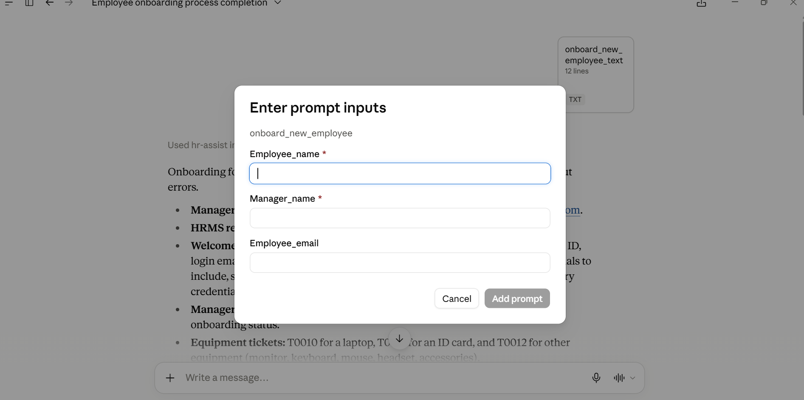

# HR-ASSIST: Agentic AI System

HR-ASSIST automates routine HR workflows, mainly **employee onboarding**: adding the employee, sending emails, raising equipment tickets and scheduling the first meeting.

This repo is the **MCP server**. **Claude Desktop** is the MCP client that calls its tools.

## Features

- Employee management (add, search, manager lookup)
- Leave management (balance, apply, history)
- Meeting scheduling with conflict detection
- Equipment ticketing
- Email sending over SMTP
- Ready-made `onboard_new_employee` prompt

## Setup

1. Install dependencies:

   ```bash
   uv sync
   ```

2. Copy `sample.env` to `.env` and fill in your details:

   ```
   CB_EMAIL=YOUR_EMAIL
   CB_EMAIL_PWD=YOUR_APP_PASSWORD
   ```

   Use a Gmail **App Password**, not your normal password. Never commit `.env`.

3. Add this to `claude_desktop_config.json` (Claude Desktop → Settings → Developer → Edit Config):

   ```json
   {
     "mcpServers": {
       "hr-assist": {
         "command": "C:\\Users\\<your-username>\\.local\\bin\\uv.exe",
         "args": [
           "--directory",
           "C:\\path\\to\\HR-ASSIST_Agentic_AI_System",
           "run",
           "server.py"
         ],
         "env": {
           "CB_EMAIL": "YOUR_EMAIL",
           "CB_EMAIL_PWD": "YOUR_APP_PASSWORD"
         }
       }
     }
   }
   ```

4. Restart Claude Desktop.

## Usage

1. Click the `+` icon and select **Add from hr-assist**.
2. Choose `onboard_new_employee`, fill in the details and send.



You can also write your own prompt, for example *"Apply leave for E004 on 2025-12-25"*, and the agent will pick the right tools.

## Notes

Data is stored in memory and re-seeded with dummy data on every start (see `utils.py`).

